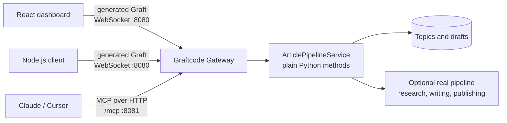
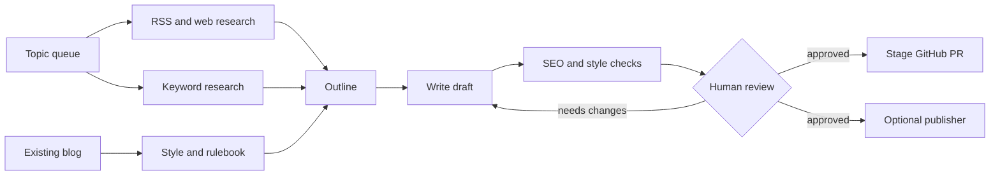

# Python ↔ TypeScript with Graftcode: a content-pipeline demo

A Python service (an article-research-and-drafting pipeline) called directly from a
TypeScript dashboard and a Node script through [Graftcode](https://graftcode.com), with
**no REST layer**: no FastAPI routes, no Pydantic DTOs, no hand-written fetch client.

```
 Browser (React) ── generated Graft ── WebSocket ─┐
 Node test script ─ generated Graft ──────────────┤
                                                  ▼
 Claude / Cursor ── MCP over HTTP ──────►  Graftcode Gateway ─► ArticlePipelineService (Python)
                                           :8080 ws · :8081 /mcp   plain public methods
```

There is no HTTP adapter: the browser imports the generated Graft and talks to the Gateway
directly. MCP is the Gateway's built-in endpoint, not a separate bridge.

It was built for [Wayzyy](https://wayzyy.com)'s content engine. **You do not need that
pipeline to run this repo:** without it the receiver runs in *demo mode* on bundled sample data.

> New to Graftcode? Watch the [three-minute Graftcode introduction](https://youtu.be/8MKrom45RUA)
> for context, then come back here to see it applied to a real project.
> Disclosure: this project is part of the Graftcode Impact Programme.

## What Graftcode does here

The Python service is a plain class with public methods. Graftcode turns those methods into
everything the clients need:

1. **The Gateway hosts the Python service.** `gg` loads `ArticlePipelineService` and serves its
   public methods on `:8080` (WebSocket). No web framework wraps it.
2. **It generates the Graft.** The React dashboard and the Node script install the generated
   package and call `getDraft(...)`, `writeArticle(...)` and the rest as ordinary typed-looking
   function calls.
3. **The same methods are exposed over MCP.** The Gateway's built-in `/mcp` endpoint lists every
   public method as a tool, so Claude or Cursor can use the pipeline without a second adapter.

**What this saved me from writing and maintaining:** FastAPI routes, Pydantic request/response
DTOs, a hand-written `fetch` client in TypeScript, and a separate FastMCP bridge (the old one is
kept in [`legacy/`](legacy/) for comparison). Calling the backend's public methods directly
means there is no integration layer to generate, review or keep in sync, which also means
less code for an AI assistant to produce and re-read on every change, and fewer tokens spent.

Graftcode's own docs: <https://docs.graftcode.com/quick-start>

## How the pieces fit together

The repository has one Python service and several ways to use it. The dashboard and Node
client use the generated Graft over WebSocket; MCP-compatible clients use the Gateway's
built-in HTTP endpoint. They all reach the same public Python methods.



The important boundary is the Python service. The UI, scripts, and AI assistants are clients
of the same service rather than separate copies of the content logic.

## The content workflow

The demo models an editorial workflow from an idea to a reviewable change. Sources and rules
inform the draft, while the human review step remains the publishing gate.



The bundled receiver runs this flow in demo mode with sample data. Attaching the real article
pipeline replaces the sample sources and placeholder writer with the project's live research,
LLM, and publishing integrations.

## Video walkthrough

A long-format walkthrough of the project is coming and will be linked here. It covers the
dashboard, the Graft calls and the MCP endpoint end to end.

For a quick visual tour, start with the dashboard, open the Topic Queue, generate or open a
draft, run the style check, and inspect the Architecture tab. The Architecture tab shows the
available MCP tools and compares local calls through the generated Graft and MCP endpoint.

## What is real and what is demo

| Method | With the real pipeline attached | Demo mode (default for new users) |
|---|---|---|
| `getPipelineStatus` | Real provider/queue status | Reports demo mode and sample counts |
| `listPendingTopics`, `getTopicSources` | Reads the scanner's review queue | Reads `receiver/sample_data/review` |
| `listDrafts`, `getDraft`, `saveDraft` | Reads/writes the writer's drafts | Reads/writes `receiver/sample_data/drafts` |
| `runStyleCheck` | Heuristic brand check on the draft text | Same |
| `suggestNextArticle` | Ranks the real queue (keyword tiers + source count) | Ranks the sample queue |
| `writeArticle` | Runs the full LLM research → outline → write pipeline | Writes a clearly labelled placeholder draft |
| `runScanner` | Runs the scanner project's `main.py --scan` | Reports `skipped (demo mode)` |
| `pushToGithub` | Opens a real GitHub PR | Raises an error (needs the pipeline) |

## The dashboard

Open <http://localhost:5173> after `start.sh`. It calls the Python receiver straight from the
browser through the generated Graft (WebSocket).

| Tab | What it exercises |
|---|---|
| Dashboard | `getPipelineStatus`, `listPendingTopics`, `listDrafts`, plus the live "Run topic scanner" and "Suggest next article" actions |
| Topic Queue | `listPendingTopics`, `getTopicSources` (the sources modal) |
| Draft Studio | `getDraft`, `saveDraft`, `writeArticle` (Auto-Pilot Draft), `runStyleCheck`, `pushToGithub` (Stage PR) |
| Style Auditor | Result of `runStyleCheck` |
| Architecture | Live benchmark of the same method through the Graft and through MCP, the live MCP tool list, and the known limits |

With the real pipeline attached, *Auto-Pilot Draft* calls LLM APIs, *Scan for New Topics* calls
the search API, and *Stage PR* can open a real pull request. In demo mode none of these cost anything.

Client settings (optional): `VITE_GRAFT_HOST` (default `ws://localhost:8080/ws`) and
`VITE_GRAFT_MCP_URL` (default `http://localhost:8081/mcp`).

## Prerequisites

- Python 3.10+ and Node 18+
- PyYAML for the configuration file: `pip install -r receiver/requirements.txt`
- The Graftcode Gateway (`gg`): <https://docs.graftcode.com/quick-start>

## Run it

```bash
bash scripts/start.sh
```

This starts the gateway, installs the freshly generated graft package into `test-client/`
and `ui/`, runs the Node → Python test, and starts the dashboard at <http://localhost:5173>.
Graft Vision (the gateway's inspector) is at <http://localhost:8081>.

```bash
bash scripts/stop.sh        # stop everything
bash scripts/start.sh --no-ui   # skip the dashboard
```

Run the Python tests (they use demo mode and need no network or keys):

```bash
cd receiver && pip install pytest && python -m pytest
```

## Make it yours: one config file

Everything niche-specific lives in a YAML file, so the same receiver, Graft, MCP tools and
dashboard can serve any blog. Copy [`receiver/config/wayzyy.yaml`](receiver/config/wayzyy.yaml),
edit it, and point `PIPELINE_CONFIG` at it before starting:

```bash
PIPELINE_CONFIG=my-blog.yaml bash scripts/start.sh
```

| Section | What it controls |
|---|---|
| `brand` | Name and description (shown in the dashboard), the topic keyword the style check looks for, the fallback research prompt |
| `categories` | How queue topics are grouped (first matching keyword rule wins, else `default`) |
| `suggestion.tiers` | Which topic keywords the "suggest next article" ranking favours, highest priority first |
| `style` | Banned words and openers, the attribution keyword (for example a stock-photo site), the publish threshold |
| `data_dir` | Folder with `review/` and `drafts/` samples used in demo mode |

Keys you leave out fall back to the built-in defaults, and a malformed file stops startup with a
clear `Config error` message. A second, non-travel example is in
[`receiver/config/examples/saas/`](receiver/config/examples/saas/config.yaml). Try it with no keys:

```bash
PIPELINE_CONFIG=receiver/config/examples/saas/config.yaml \
WAYZYY_WRITER_DIR=/nonexistent WAYZYY_SCANNER_DIR=/nonexistent bash scripts/start.sh
```

What the config does **not** cover: the real article pipeline's prompts and brand voice. Those
live in the separate pipeline project you attach with `WAYZYY_WRITER_DIR`.

## Attach the real pipeline (optional)

Copy `.env.example` and export the variables you need, for example `WAYZYY_WRITER_DIR`,
`WAYZYY_SCANNER_DIR` and `WAYZYY_SITE_DIR`. The pipeline reads its own LLM and search keys
from its own `.env`; this repo never stores secrets.

## Use it from Claude or Cursor (MCP)

The Gateway serves every public receiver method as an MCP tool at `http://localhost:8081/mcp`
(JSON-RPC over HTTP with an `Mcp-Session-Id` session). Check it from a terminal:

```bash
bash scripts/mcp-check.sh
```

**Cursor** (`.cursor/mcp.json`):

```json
{ "mcpServers": { "graft-content-pipeline": { "url": "http://localhost:8081/mcp" } } }
```

**Claude Desktop** only speaks stdio, so bridge the endpoint with `mcp-remote`:

```json
{
  "mcpServers": {
    "graft-content-pipeline": {
      "command": "npx",
      "args": ["-y", "mcp-remote", "http://localhost:8081/mcp"]
    }
  }
}
```

MCP tool names are the Python method names (`suggest_next_article`, `write_article`, ...). Results
come back as JSON text. The earlier hand-written FastMCP bridge is kept in `legacy/` as a
"before" comparison only.

## Verify it yourself

- **No HTTP layer between the UI and Python:** `grep -rn "fetch(" ui/src` only finds the MCP
  client in `ui/src/graft.ts`; there are no route handlers anywhere in the repo.
- **MCP is built in:** `bash scripts/mcp-check.sh` lists the Gateway's tools with no extra process running.
- **Latency:** open the dashboard's Architecture tab and press *Run 20 calls each*. It times the same
  method through the Graft and through MCP on your machine. The numbers are local round trips only.

## Suggested screenshots for the README

Screenshots are optional, but these four make the project much easier to evaluate:

1. **Pipeline overview:** the dashboard showing Topic Queue, research, drafting, review, and
   GitHub staging as the main path.
2. **Draft Studio:** a generated draft beside its style-check result, including the score,
   passed rules, and any fixes still required.
3. **Architecture:** the Architecture tab showing the Gateway, MCP tool count, and the local
   Graft-versus-MCP comparison.
4. **GitHub staging:** the result after `pushToGithub`, with the branch and pull-request URL
   visible. Use a test repository and redact tokens, private URLs, and customer content.

Place them in `docs/images/` and embed them next to the relevant section, for example:

```md

```

The most valuable first screenshot is the pipeline overview. It communicates the product in a
few seconds; the architecture and GitHub screenshots then prove how the integration works.

For the expanded diagrams and demo notes, see the [architecture guide](docs/architecture.md).

## Layout

```
receiver/article_receiver/service.py   the Python receiver (plain class, public methods)
receiver/config/                       default config and a non-travel example
receiver/sample_data/                  demo-mode topics and drafts
receiver/tests/                        pytest suite
scripts/                               start.sh, stop.sh, run_gateway.sh, mcp-check.sh
test-client/                           Node script calling the receiver through the graft
ui/                                    Vite + React dashboard (calls the Gateway directly)
legacy/                                the superseded FastMCP bridge (comparison only)
```

## Notes and limitations

- **Typed returns.** The receiver defines dataclasses for its results, but with the Graftcode
  Node SDK at the time of writing, object results reach Node as opaque handles (fields are not
  readable as plain properties; lists are not arrays). The public methods therefore return
  JSON strings, and the dataclasses serve as the schema.
- **Package names and registry IDs change.** The generated package name and the registry ID
  can differ per machine and per gateway restart, so `start.sh` reads them from the gateway log
  and writes `graft-package.json` for the callers.
- **Draft files are sandboxed.** Draft filenames must be plain names. Absolute paths, `..`, and symlinks that
  resolve outside the drafts folder are rejected for every method that reads or writes a draft (regression
  tests in `receiver/tests/test_security.py`). The gateway itself still has no authentication, so this
  limits what a caller can reach but does not replace authentication.
- **Security.** The gateway only allows `http://localhost:5173` by default (`GRAFT_CORS`), has
  no authentication (including on `/mcp`), and `pushToGithub` can open PRs when configured. Do not expose it publicly.
- **Typed returns in the browser too.** The same opaque-handle behaviour applies to the browser
  SDK, so the dashboard also receives JSON strings and parses them.
- **Dashboard shows "MCP: offline"?** The browser must be allowed to read the `Mcp-Session-Id`
  header. `run_gateway.sh` writes a CORS config for `http://localhost:5173`; if you serve the
  dashboard from another origin, set `GRAFT_CORS` and restart.
- **Port already in use?** Run `bash scripts/stop.sh`, or change `GRAFT_PORT`, `GRAFT_VISION_PORT`.
- **Python not found by the gateway?** Set `PY_HOME` to your Python prefix
  (for example the python.org framework build) and re-run.

## License

[MIT](LICENSE). The Graftcode gateway (`gg`) and the generated Graft packages are
Graftcode's own software and are governed by their terms; this repository does not redistribute them.
